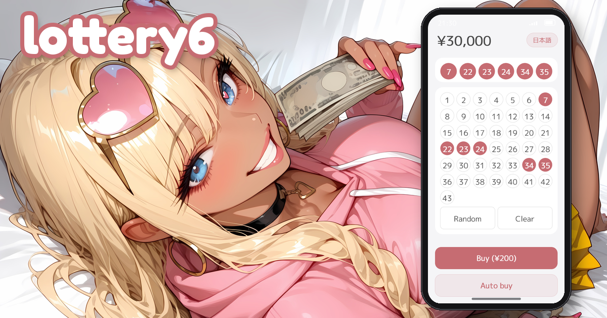
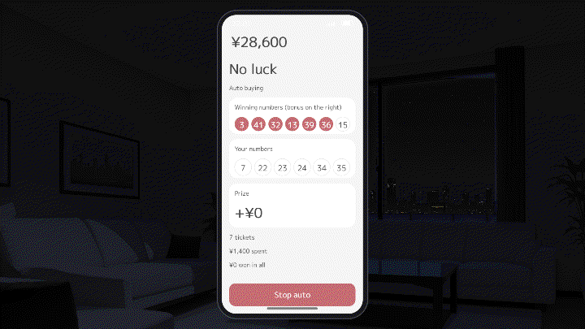
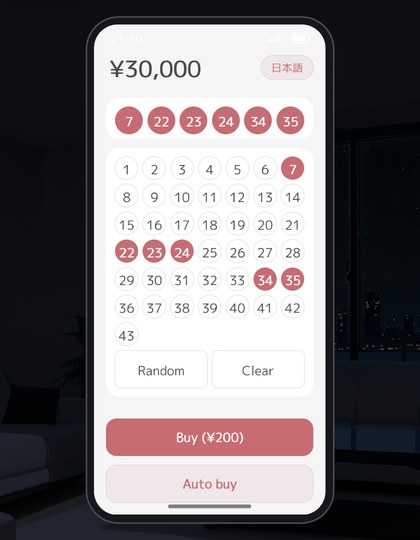
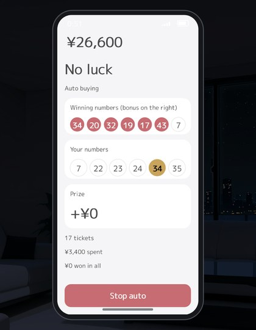
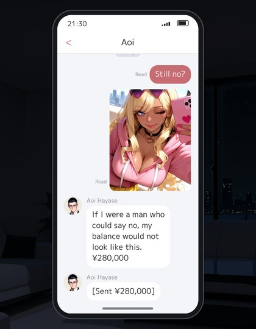

[](https://github.com/nao1215/lottery6/actions/workflows/check.yml)
[](https://github.com/nao1215/lottery6/actions/workflows/pages.yml)
[](https://github.com/nao1215/lottery6/actions/workflows/gitleaks.yml)
[](https://github.com/nao1215/lottery6/actions/workflows/trivy.yml)
[](https://github.com/nao1215/lottery6/actions/workflows/osv-scan.yml)
[](https://github.com/nao1215/lottery6/releases)
[](./LICENSE)
[](https://scorecard.dev/viewer/?uri=github.com/nao1215/lottery6)
[](https://github.com/nao1215/gozen)



lottery6 is a number lottery game for web browsers, on PC or your phone. You pick 6 of 43 numbers on a phone, buy a ticket for ¥200, and see the draw at once. A gyaru who all but lives in her friend Aoi's tower apartment plays it with his money. When she runs out, she sends him a selfie and asks for more. It is a project for learning how to make a game with AI, made with [gozen](https://github.com/nao1215/gozen). The game is in Japanese and English. It starts in your browser's language, and the button at the top right of the phone switches between them.

<p align="center"><b>▶ <a href="https://nao1215.github.io/lottery6/">Play in your browser</a></b> — no download, on PC or your phone · or get a zip for your desktop from <a href="https://github.com/nao1215/lottery6/releases">the releases</a></p>

<p align="center"></p>

| Pick six numbers | The draw | Out of money: ask Aoi |
| :---: | :---: | :---: |
|  |  |  |

## How to play

Tap six numbers, or Random, then Buy. The drawn numbers light up one by one, and yours turn gold where they match. Auto buy keeps buying the same numbers until you stop it. When the money runs out, she asks Aoi in a chat with a selfie attached, and he sends about ¥300,000 with a polite and rather unkind reply.

The odds and the prizes are those of a real 6-of-43 lottery:

| Prize | Match | Odds | Amount |
| --- | --- | --- | --- |
| 1st | 6 | 1 in 6,096,454 | ¥200,000,000 |
| 2nd | 5 and the bonus | 1 in 1,016,076 | ¥10,000,000 |
| 3rd | 5 | 1 in 28,224 | ¥300,000 |
| 4th | 4 | 1 in 610 | ¥6,800 |
| 5th | 3 | 1 in 39 | ¥1,000 |

Each ticket moves the clock on three minutes, and the window of Aoi's room turns from day to evening to night. The game saves after every ticket and picks up where you left it. On a phone held upright the screen is upright; on a PC, or a phone on its side, it is wide.

## Controls

| Action | Touch / mouse | Keyboard |
| --- | --- | --- |
| Pick a number, press a button | Tap it | ← → to the button, Enter |
| Settings (volume, text speed) | — | O |

## How it was made

I generated the pictures with an SDXL model in my own pipeline, then cut them out and composed them with the Python scripts in `tools/`. The gyaru is the one from [Rabbit Run](https://github.com/nao1215/rabbitrun), and Aoi is the hero of another game of mine. The sound effects come from my RPG, where I synthesized them with numpy. `tools/build.py` writes `game/game.yaml` and `game/data/world.yaml`, and `tools/en.py` holds the English text.

## License

[MIT License](./LICENSE), with the fonts and the gozen player under their own terms: see [NOTICE.md](./NOTICE.md).

### Verifying release integrity

Each release has `checksums.txt`, its keyless cosign signature, a GitHub build attestation of every zip and SLSA provenance (`multiple.intoto.jsonl`).

```shell
cosign verify-blob \
  --bundle checksums.txt.sigstore.json \
  --certificate-identity "https://github.com/nao1215/lottery6/.github/workflows/release.yml@refs/tags/vX.Y.Z" \
  --certificate-oidc-issuer https://token.actions.githubusercontent.com \
  checksums.txt
sha256sum --ignore-missing -c checksums.txt
gh attestation verify lottery6_linux-amd64.zip --repo nao1215/lottery6
slsa-verifier verify-artifact --provenance-path multiple.intoto.jsonl --source-uri github.com/nao1215/lottery6 --source-tag vX.Y.Z lottery6_linux-amd64.zip
```
